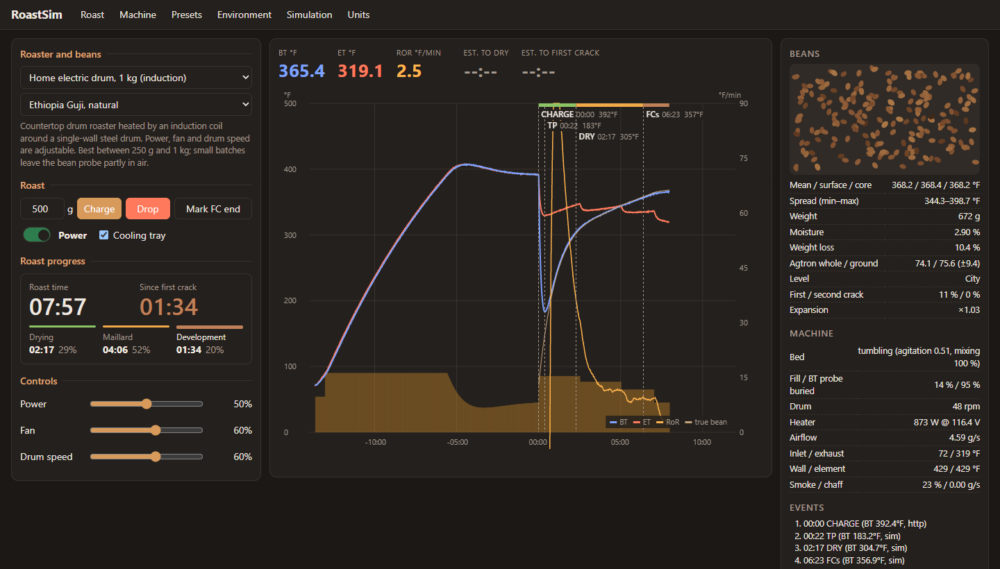
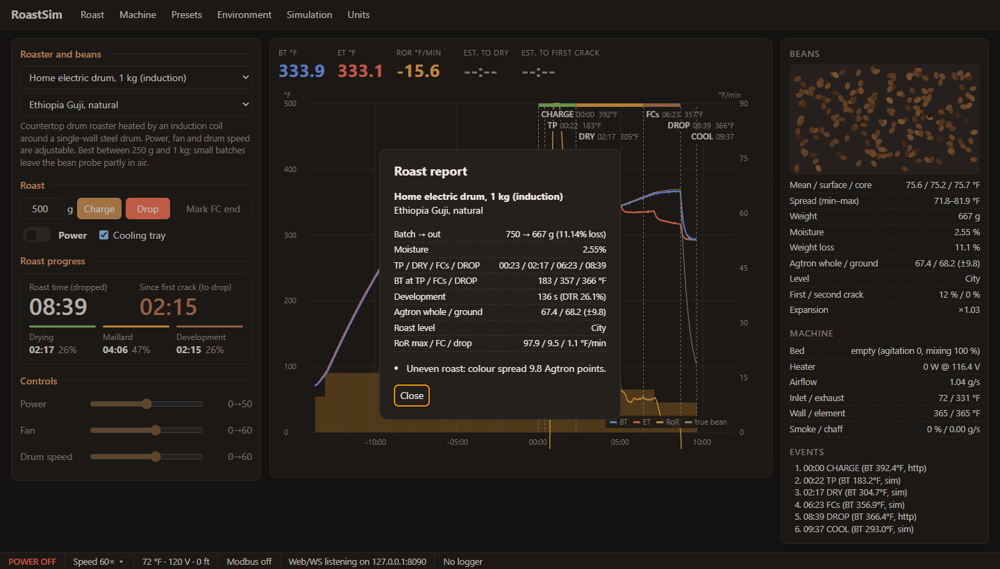
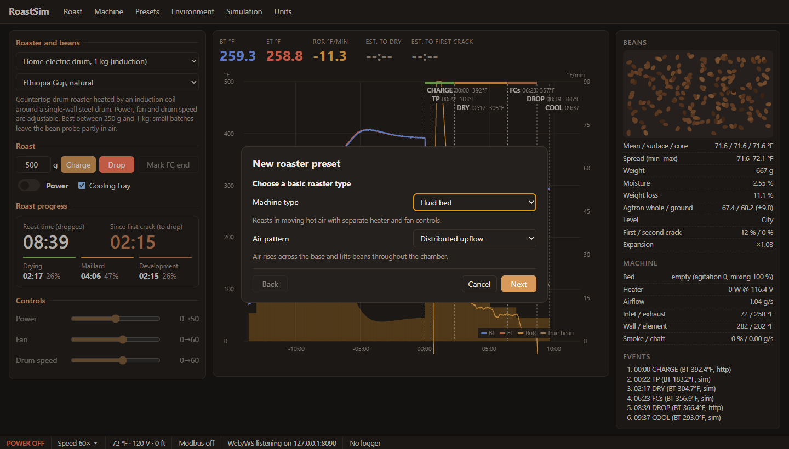
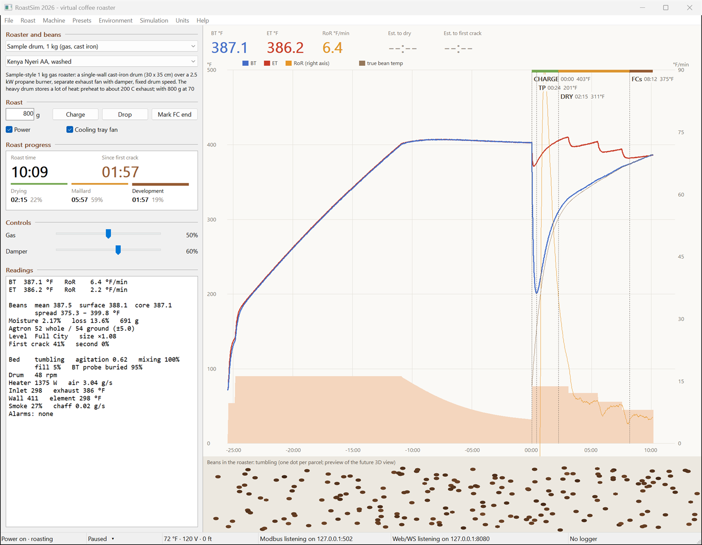

<div align="center">

# ☕ RoastSim 2026

**A virtual coffee roaster that Artisan connects to as if it were real hardware.**

It simulates the heat transfer, moisture loss, browning, cracks, smoke, sound and probe behaviour of air, drum and pan roasters, so you can practise profiles, test logger setups and teach roasting without burning a single real bean.


<br>

<picture>
  <source media="(prefers-color-scheme: light)" srcset="docs/images/web-roast-light.png">
  
</picture>

<sub>The web control panel during a roast, 1:34 past first crack. It switches between light and dark themes to match your system.</sub>

</div>

---

## Highlights

|  |  |
|---|---|
| 🔥 **Real roast physics** | A bean-parcel model covering heat transfer, moisture, browning (Agtron whole/ground/spread), first and second crack, expansion, smoke and chaff, with roast defects in the report. |
| 🏭 **Many machines** | Fluid-bed air roasters, popcorn poppers (stock and modded), home, sample and shop drums (induction, IR, gas) and stir-arm pans. You can also describe your own roaster in JSON or build one in the wizard. |
| 📈 **Artisan-ready** | **Modbus TCP**, **WebSocket** (Artisan's default dialect, with auto CHARGE/DROP/crack marks) and **TC4/aArtisanQ serial**. |
| 🖥️ **Three front ends** | A native Windows app, a browser UI, and a headless console. All of them share one command API. |
| 🔊 **You can hear it** | Blower, burner, drum, tumbling beans, and every crack voiced from the bean's size, hardness and moisture. |
| 🧪 **Probe faults** | Open, shorted, drifting, spiking, stuck or noisy probes for testing your Artisan setup. You can also blow the popper's thermal fuse. |
| ⏩ **Time control** | Pause, or run up to 120× when no logger is connected. It locks to real time while Artisan is connected. |

## Screenshots

<table>
  <tr>
    <td width="50%" valign="top">
      <picture>
        <source media="(prefers-color-scheme: light)" srcset="docs/images/web-report-light.png">
        
      </picture>
      <p align="center"><b>Roast report</b><br><sub>Times, DTR, Agtron whole/ground, weight loss, RoR, and notes on what went wrong.</sub></p>
    </td>
    <td width="50%" valign="top">
      <picture>
        <source media="(prefers-color-scheme: light)" srcset="docs/images/web-wizard-light.png">
        
      </picture>
      <p align="center"><b>Preset wizard</b><br><sub>Build a roaster from a fluid-bed, electric-drum, gas-drum or stir-pan starter.</sub></p>
    </td>
  </tr>
</table>

<p align="center">
  
  <br>
  <sub><b>Native Windows app</b>: a Kenya AA in a 1 kg cast-iron gas sample drum, dropping at Full City with a 19% DTR.</sub>
</p>

## What's included

| Program | What it does |
|---|---|
| `roastsim_win32.exe` | Native Windows control panel. It hosts all the servers. |
| `roastsimd(.exe)` | Headless simulator and console with the same servers. Runs on Windows, Linux and Haiku. |
| `roastsim_script` | Runs scripted roasts at full speed for calibration, testing and teaching. |
| `roastsim_check` | Validates presets and runs reference roasts. |
| `roastsim_sound` | Renders the roaster's sound to a WAV file. |
| `http://localhost:8080/` | Web control panel, served by either simulator. |

**Roasters out of the box:** fluid-bed air roaster · spouted-bed pilot · stock popcorn popper (variac, thermostat, thermal fuse) · modded popper (SSR heater + separate fan) · home induction drum 1 kg · tabletop IR drum 250 g · gas sample drum 1 kg · shop gas drums 5 kg and 15 kg · stir-arm pan.

**Beans:** Brazil natural · Colombia washed · decaf (water process) · Ethiopia natural · Guatemala Huehuetenango · Kenya washed · Kenya pilot blend · Sumatra wet-hulled. Add your own in `data/beans/`.

## Quick start

### Windows

You need MSYS2's UCRT64 toolchain (`C:\msys64\ucrt64\bin`) on `PATH`.

```powershell
cmake -S . -B build -G Ninja
```

```powershell
cmake --build build
```

```powershell
.\build\roastsim_win32.exe
```

The binaries are statically linked, so you can copy `build\*.exe` anywhere along with `build\data` and `build\web`.

### Linux / Haiku

The core and service layers are portable C++17. All OS-specific code is isolated in `service/src/platform_*.cpp`.

```sh
cmake -S . -B build && cmake --build build
./build/roastsimd --lan --tc4 pty      # web UI on :8080, Modbus on :502, TC4 on a pty
```

On Linux, port 502 needs privileges, so use `--modbus-port 5020` and set the same port in Artisan. Native GTK and Haiku BeAPI shells are planned against the same C API; see [apps/gtk/README.md](apps/gtk/README.md) and [apps/haiku/README.md](apps/haiku/README.md).

### Connect Artisan

> **Config » Device » MODBUS**: host `127.0.0.1`, port `502`, Input 1 register 1 (ET), Input 2 register 0 (BT), function 3, divider 1/10, int16.

The full guide, including WebSocket and TC4, is in [docs/ARTISAN_SETUP.md](docs/ARTISAN_SETUP.md).

## Using it

1. **Power on.** The machine boots switched off. Flip the power switch in the web UI or native app, or type `power on` in the console. While it's off, the dials keep their settings but nothing heats, blows or turns, and the machine cools to ambient. The graph starts at power-on and ends with the roast report at COOL, when the UI switches the machine off again.
2. **Roast.** Pick a roaster and bean, set the batch size, then **Preheat** (drums only). Set heat and fan, **Charge**, and watch for the turning point, DRY and first crack (you'll hear the cracks). Then **Drop**. The roast report appears when cooling ends.
3. **Review.** The report covers times, DTR, Agtron whole/ground/spread, weight loss and defects.

<details>
<summary><b>Environment</b></summary>

Set the ambient temperature, line voltage and sag, altitude, humidity and gas pressure. Loading a roaster sets its rated wall voltage. To simulate a different supply, use the Environment dialog.
</details>

<details>
<summary><b>Custom presets</b></summary>

* Choose **Presets → New roaster** and start from a fluid bed, electric drum, gas drum, or stir pan. To adjust a custom roaster, select it and use **Edit selected roaster**.
* Choose **New bean** to start from a bean template, or **Edit selected bean** to change one. Editing a bundled bean saves a custom copy.
* Custom presets are kept across restarts. To apply a roaster's saved settings, load or reload it.
* **Control levels:** in the wizard or editor, set **Heat levels** and **Fan levels** independently. Enter 8 for levels 1–8 plus Off, or 0 for a percentage slider. Numbered levels are spaced evenly up to full output.
* **Fluid-bed air patterns:** on the **Machine type** page, choose **Fluid bed**, then pick **Distributed upflow**, **Central spout**, **Tangential swirl**, or **Side jet**. You can change it later under **Airflow** in the editor. The pattern affects how easily the air lifts the beans, how they mix and heat, and how easily they get carried out at high fan settings.
</details>

<details>
<summary><b>Faults</b></summary>

Inject open, shorted, drifting or spiking probes to test Artisan setups. To blow the popper's thermal fuse, choke its airflow, then use **Repair** to replace it.
</details>

<details>
<summary><b>Speed</b></summary>

Pause, or run at 1–120× when no logger is connected. When Artisan connects, the simulation locks to real time.
</details>

<details>
<summary><b>Sound</b></summary>

Hear the blower, burner and drum, the beans tumbling, and every first and second crack. Each crack is voiced from the bean's size, hardness and moisture, so a dense Kenya pops loud and deep while a decaf barely ticks. Turn it on with **Simulation ▸ Sound** in the Win32 app, the **Sound** checkbox in the web UI, or `roastsimd --sound`. `roastsim_sound` renders WAV files offline. See [docs/SOUND.md](docs/SOUND.md).
</details>

## Testing

```powershell
.\build\roastsim_tests.exe data
```

The suite covers:
* physics envelopes for every preset
* the density effect
* crack sounds per bean and the sound engine
* determinism
* Modbus framing and registers
* the Artisan WebSocket dialect and push messages
* HTTP, TC4 commands and the C API

## Documentation

| Doc | Contents |
|---|---|
| [ARTISAN_SETUP](docs/ARTISAN_SETUP.md) | Connecting Artisan over Modbus, WebSocket or TC4 |
| [API](docs/API.md) | The JSON command set over WebSocket, HTTP, C API and console |
| [PHYSICS](docs/PHYSICS.md) | The bean-parcel model and machine physics |
| [SOUND](docs/SOUND.md) | The sound engine and crack voicing |
| [ARCHITECTURE](docs/ARCHITECTURE.md) | Layering, platform split and the 3D view plan |

## Project layout

```
core/      pure C++17 simulation (no OS code): beans, machines, probes, scenarios
service/   host (real-time thread, JSON API), Modbus/HTTP/WebSocket/TC4, platform layer, C API
apps/      roastsimd (headless), win32 (native shell), gtk + haiku (planned)
web/       browser control panel (served by the host)
data/      roaster and bean presets (JSON; add your own)
scripts/   scripted calibration roasts
tests/     test-suite
docs/      ARCHITECTURE (incl. the 3D plan), ARTISAN_SETUP, API, PHYSICS, SOUND, images
```
